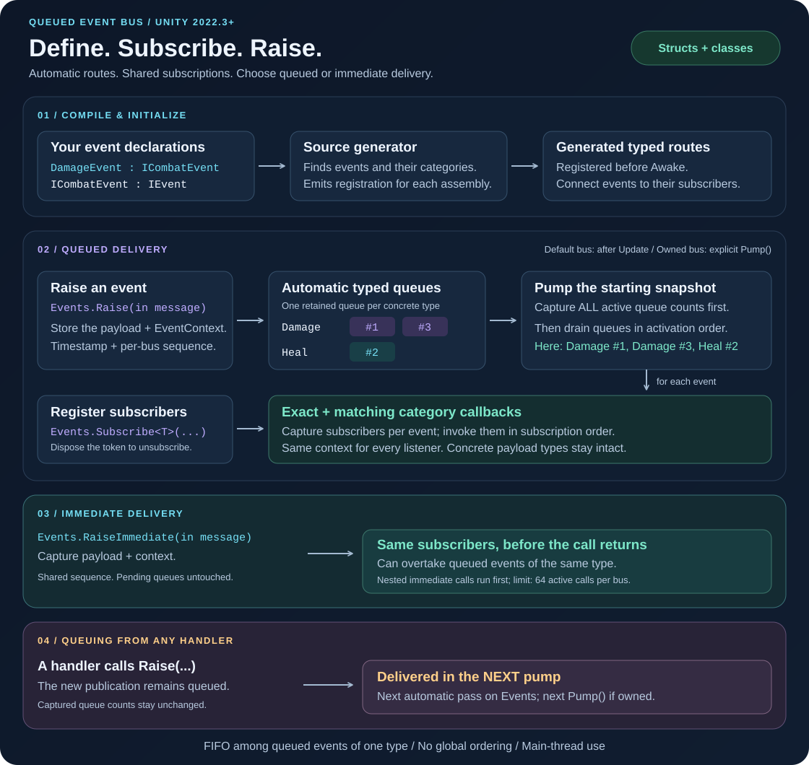

# Queued Event Bus

A Unity 2022.3+ package for typed, queued notifications. Declare events implementing `IEvent`, subscribe, and raise. The bus creates concrete queues automatically; a bundled source generator connects events to their base classes and interfaces.



## Quick start

```csharp
using QueuedEventBus;
using UnityEngine;

/// <summary>Reports damage dealt to a target.</summary>
public readonly struct DamageEvent : IEvent
{
    /// <summary>Creates a damage notification.</summary>
    /// <param name="amount">The damage amount.</param>
    public DamageEvent(int amount)
    {
        Amount = amount;
    }

    /// <summary>Gets the damage amount.</summary>
    public int Amount { get; }
}

/// <summary>Subscribes while enabled and raises an example damage notification.</summary>
public sealed class HealthEventsExample : MonoBehaviour
{
    private Subscription _subscription;

    private void OnEnable()
    {
        _subscription = Events.Subscribe<DamageEvent>(OnDamage);
    }

    private void Start()
    {
        Events.Raise(new DamageEvent(10));
    }

    private void OnDisable()
    {
        _subscription.Dispose();
    }

    private static void OnDamage(in DamageEvent message)
    {
        // Handle message.Amount.
    }
}
```

The default bus delivers after `MonoBehaviour.Update`. Events raised while it delivers wait until the next frame. Order is FIFO within each concrete event type. Separate event types have separate queues, so there is no global delivery order.

Use `new EventBus()` and call `Pump()` explicitly for isolated systems or EditMode tests. The default facade is for Play mode; initialization completes before scene `Awake` calls. All bus operations belong on the bus's owning thread; use the Unity main thread for `Events`.

## How it works

**At compile time**, the generator finds concrete events implementing `IEvent` and emits registration for their concrete type and every distinct event base class and interface. Unity compiles that generated code into the event's assembly and registers the routes automatically before scene `Awake`. Event declarations need no attributes or `partial`, and registration requires no handwritten list.

**At raise time**, the bus captures the payload and its `EventContext` in a typed ring buffer, creating one queue per concrete event type as needed. A struct payload stays a struct throughout routing and delivery. Class payloads retain their original reference, so keep their contents stable while queued. Categories such as `ICombatEvent` are subscription groups over these queues, not additional queues or payload copies.

**At pump time**, the bus captures the pending count of every active queue before invoking any handler, then drains those counts completely. Channels run in activation order and each channel preserves FIFO. Exact and matching category subscriptions share one callback list ordered by registration; a category reached through multiple inheritance paths still matches only once per subscription.

### A frame in practice

Assume empty queues, with `DamageEvent` and `HealEvent` both implementing `ICombatEvent`. The `#` values are `EventContext.Sequence` values on one bus.

| When | Action | Result |
| --- | --- | --- |
| Frame N: `Update` | Raise `Damage #1`, `Heal #2`, `Damage #3`. | Damage queue: `[#1, #3]`; Heal queue: `[#2]`. Damage became active first. |
| Frame N: pump begins | Capture **both** queue counts before callbacks. | This pump will drain two Damage events and one Heal event. |
| Frame N: first delivery | Deliver `Damage #1`; one callback raises `Heal #4`. | `Heal #4` is queued with its own context, but is outside this pump's captured counts. |
| Frame N: remaining deliveries | Deliver `Damage #3`, then `Heal #2`. | Every event invokes its matching exact and category subscribers in registration order. |
| Frame N+1: next pump | Deliver the pending `Heal #4`. | Handler-raised events always wait for the next pump, including events targeting a queue not yet drained. |

The resulting order is **`Damage #1` → `Damage #3` → `Heal #2`**, then `Heal #4` on the next pump. Publication sequence identifies when events were raised; it does not impose a global delivery order. On a custom bus, the boundary is your next explicit `Pump()` call instead of the next Unity frame.

**Subscriber selection happens for each event when it is delivered.** Subscribing after `Raise` but before delivery can receive an already queued event. A callback that subscribes or unsubscribes changes the next event's listener list, even within the same pump; the current event completes the list it already captured. Separate subscription calls each produce a delivery, even for the same callback or handler. Handler exceptions are reported individually, and delivery continues.

Typed generated adapters retain the concrete type when calling a category handler, avoiding payload boxing and runtime inheritance discovery. The generator prepares routing; the runtime owns queue creation, metadata capture, subscriptions, and dispatch.

## Install

Copy `Packages/com.eventbus.queued` into your project's `Packages` directory, or choose **Add package from disk** in Package Manager and select this package's `package.json`. Once this repository is hosted, Git installation uses its repository URL with `?path=/Packages/com.eventbus.queued`.

Keep the included `.meta` files. The generator DLL already carries Unity's required `RoslynAnalyzer` label and disabled plugin platform settings. Projects with assembly definitions must reference `QueuedEventBus.Runtime`. The generator runs for assemblies referencing that runtime, so event declarations require neither attributes nor `partial`.

Import **Basic Events** from the package's Samples tab for working MonoBehaviour examples.

## Category subscriptions

```csharp
/// <summary>Groups notifications about combat targets.</summary>
public interface ICombatEvent : IEvent
{
    /// <summary>Gets the affected target's identifier.</summary>
    int TargetId { get; }
}

/// <summary>Receives all concrete combat event types.</summary>
public sealed class CombatHandler : IEventHandler<ICombatEvent>
{
    /// <summary>Handles a combat notification without erasing its concrete type.</summary>
    /// <typeparam name="T">The concrete combat event type.</typeparam>
    /// <param name="message">The event payload.</param>
    public void Handle<T>(in T message) where T : ICombatEvent
    {
        // Read message.TargetId without converting the struct into an interface.
    }
}

```

Subscribe from `OnEnable` with `Events.Subscribe<ICombatEvent>(new CombatHandler())` and retain the returned token for disposal in `OnDisable`.

`Subscribe<T>(EventCallback<T>)` observes exactly `T`. `Subscribe<TBase>(IEventHandler<TBase>)` observes all concrete events inheriting or implementing `TBase`, including that type itself if concrete. Multiple matching inheritance paths produce one invocation per subscription; two separate subscriptions produce two invocations.

## Publication metadata

Every `Raise` captures an immutable `EventContext` beside the payload. Opt into it by adding a context parameter to an exact callback:

```csharp
static void OnDamage(in DamageEvent message, in EventContext context)
{
    long elapsedTicks = System.Diagnostics.Stopwatch.GetTimestamp() - context.RaisedTimestamp;
    double queuedSeconds = elapsedTicks / (double)EventContext.TimestampFrequency;

    // context.Sequence identifies this publication within its bus lifetime.
    // Read message.Amount and queuedSeconds here.
}
```

Subscribe with the usual `Events.Subscribe<DamageEvent>(OnDamage)` call. Category handlers can implement `IEventHandlerWithContext<ICombatEvent>` and `Handle<T>(in T message, in EventContext context) where T : ICombatEvent`. Existing payload-only callbacks and handlers remain supported, and both forms share subscription order.

`RaisedTimestamp` is a raw `Stopwatch.GetTimestamp()` reading with an arbitrary clock origin. Convert differences using `TimestampFrequency`; it is neither UTC nor Unity scaled game time. `Sequence` starts at one and increases across every concrete type on one bus. It restarts for each new bus and Play session; it is not globally unique and does not impose global delivery order.

Raising the same class instance twice gives each publication independent metadata. The bus still holds the same payload reference for both; keep its data stable until delivery. Import the `MetadataListener` sample for exact and category examples.

## Performance contract

Typed queues and generated constrained adapters avoid event boxing. Warmed publication and delivery are designed to allocate zero bus memory when queue and scheduler capacities are sufficient. Use `Prewarm<T>(capacity)` before a burst and establish subscriptions before measuring.

Publication metadata contains two 64-bit values: 16 bytes of data per retained queue slot, with possible additional payload alignment padding. Each raise reads the timestamp clock. Metadata uses value storage and adds no per-publication managed allocation; measure its throughput and memory cost on the target platform.

Initialization, queue growth, subscriptions and unsubscriptions, exception reporting, and application callbacks can allocate. Class events are references to caller-owned objects; constructing them is an application allocation, and the bus does not copy their contents. There is no hard throughput guarantee: benchmark your payloads, listener counts, and target player backend.

See [the API and behavior guide](Documentation~/guide.md) for ordering, exception handling, ownership, source-generation restrictions, and IL2CPP validation. Samples deliberately log messages and therefore allocate in callbacks.
